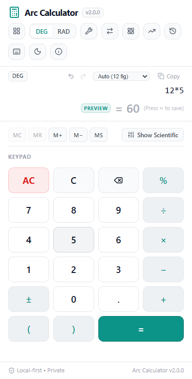

# Arc Calculator 2.0

> A professional scientific calculator and engineering toolkit for university students, built with mathematical rigor, physical calculator workflows (inspired by Casio fx-991CW), interactive graphing, and zero `eval()` dependencies.

[](https://github.com/ranaaryandev/arc-calculator/actions/workflows/ci.yml)
[](https://github.com/ranaaryandev/arc-calculator/actions/workflows/deploy.yml)
[](https://github.com/ranaaryandev/arc-calculator)
[](https://github.com/ranaaryandev/arc-calculator)
[](LICENSE)

🌐 **Live Demo:** [https://ranaaryandev.github.io/arc-calculator/](https://ranaaryandev.github.io/arc-calculator/)  
📦 **GitHub Repository:** [https://github.com/ranaaryandev/arc-calculator](https://github.com/ranaaryandev/arc-calculator)

---

## Overview

**Arc Calculator 2.0** is an open-source, local-first scientific calculator and engineering computation suite designed for engineering and science university students across all four years of study (Electrical, Mechanical, Civil, Computer, and Science).

It combines the familiar ergonomics and physical workflow of modern academic scientific calculators (such as the Casio fx-991CW) with the speed, clarity, and interactive capabilities of modern web applications — featuring **11 dedicated calculator modes**, **12 discipline-specific engineering solvers**, **interactive 2D function graphing**, and **11 unit conversion categories**, all running client-side with ₹0 operating budget and zero backend dependencies.

---

## Screenshots

| Desktop View | Mobile View (375px) |
| :---: | :---: |
|  |  |

---

## 11 Dedicated Calculator Modes

Switch modes instantly via the top header **`[MODE]`** button or keyboard shortcut `M` (fx-991CW inspired grid):

1. **Calculate Mode**: Standard and scientific arithmetic with collapsible scientific keys, memory store/recall (`MC`, `MR`, `M+`, `M−`, `MS`), and precision control.
2. **Equation Solver**:
   - **Quadratic Equations ($ax^2 + bx + c = 0$)**: Discriminant $\Delta$, real/complex conjugate roots ($u \pm vi$), vertex coordinates $(h, k)$.
   - **Linear Equations ($ax + b = 0$)**: Exact root solution.
   - **$2 \times 2$ Linear Systems**: Cramer's rule determinant method with singular matrix detection.
   - **$3 \times 3$ Linear Systems**: Gaussian elimination with partial pivoting and back-substitution.
3. **Matrix Calculator**:
   - $2 \times 2$ and $3 \times 3$ interactive matrix grids.
   - Operations: $A + B$, $A - B$, $A \times B$, scalar $k \cdot A$, transpose $A^T$, determinant $\det(A)$, trace $\text{tr}(A)$, and Gauss-Jordan matrix inversion $A^{-1}$.
4. **Vector Calculator**:
   - 2D and 3D vector coordinates ($u, v$).
   - Operations: Magnitude $\|u\|$, addition $u+v$, subtraction $u-v$, dot product $u \cdot v$, 3D cross product $u \times v$, unit vector $\hat{u}$, angle between vectors $\theta$, and vector projection $\text{proj}_v u$.
5. **Complex Numbers**:
   - Rectangular form ($a + bi$) and Polar form ($r \angle \theta$) with live bidirectional conversions.
   - Operations: $z_1 + z_2$, $z_1 - z_2$, $z_1 \times z_2$, $z_1 / z_2$, modulus $|z|$, principal argument $\text{Arg}(z)$, conjugate $\bar{z}$, and De Moivre exponentiation $z^n$.
6. **Statistics**:
   - 1-Variable Summary: $n$, $\sum x$, $\sum x^2$, mean $\bar{x}$, median, mode, sample variance $s^2$, population variance $\sigma^2$, sample standard deviation $s$, population standard deviation $\sigma$, min, max, range, and quartiles ($Q_1, Q_3, IQR$).
   - 2-Variable Linear Regression: Least-squares regression slope ($m$), intercept ($c$), Pearson correlation coefficient ($r$), and coefficient of determination ($r^2$).
7. **Probability & Distributions**:
   - Permutations ($nPr$) and Combinations ($nCr$).
   - Binomial Distribution: Probability mass function (PMF) and cumulative distribution function (CDF) for $B(n, p)$.
   - Normal Distribution: Standard probability density function (PDF) and cumulative distribution function (CDF) using the Abramowitz & Stegun error function approximation.
8. **Base-N & Digital Logic**:
   - Synchronous multi-base display across Decimal (DEC), Binary (BIN), Octal (OCT), and Hexadecimal (HEX).
   - Bitwise operations: `AND`, `OR`, `XOR`, `NOT`, Left Shift (`SHL`), and Right Shift (`SHR`).
   - Configurable word sizes (8-bit, 16-bit, 32-bit) with two's complement signed evaluation.
9. **Function Table**:
   - Generates tabular evaluations of $f(x)$ across user-defined range $[x_{\text{start}}, x_{\text{end}}]$ with customizable step sizes, discontinuity detection, and safety limits.
10. **2D Function Grapher**:
    - Multi-curve plotting ($f(x)$ and $g(x)$) on an interactive canvas with zoom, pan, origin reset, asymptotic discontinuity detection, and coordinate tracing.
11. **Engineering Toolkit**:
    - Dedicated solvers for Electrical, Mechanical, Civil, and Computer Engineering (detailed below).

---

## University Engineering Toolkit

12 verified engineering calculators with governing formulas, input parameters, SI units, and worked calculation steps:

### Electrical Engineering
- **Ohm's Law & DC Power**: Calculate Voltage ($V$), Current ($I$), Resistance ($R$), and Power ($P = VI = I^2 R = V^2/R$).
- **Voltage Divider Rule**: Compute output voltage $V_{\text{out}} = V_{\text{in}} \cdot \frac{R_2}{R_1 + R_2}$.
- **Series & Parallel Resistors**: Compute equivalent resistance for arbitrary resistor pairs.
- **RC Time Constant & Cutoff Frequency**: Calculate time constant $\tau = RC$ and $-3\text{ dB}$ cutoff frequency $f_c = \frac{1}{2\pi RC}$.
- **AC Series RLC Reactance & Impedance**: Inductive reactance $X_L = 2\pi f L$, capacitive reactance $X_C = \frac{1}{2\pi f C}$, total impedance $Z = \sqrt{R^2 + (X_L - X_C)^2}$, and phase angle $\phi$.

### Mechanical Engineering
- **Newton's Second Law**: Force $F = ma$ or acceleration $a = F/m$.
- **Stress, Strain & Young's Modulus**: Normal stress $\sigma = F/A$, axial strain $\varepsilon = \Delta L / L_0$, and Young's modulus $E = \sigma / \varepsilon$.
- **Mechanical Torque**: Torque $\tau = r F \sin(\theta)$ with lever arm and applied angle.
- **Kinetic & Potential Energy**: Kinetic energy $KE = \frac{1}{2}mv^2$ and gravitational potential energy $PE = mgh$.
- **Thermal Linear Expansion**: Length change $\Delta L = \alpha L_0 \Delta T$ and final length.

### Civil Engineering
- **Concrete Slab & Footing Volume**: Volume in cubic meters ($L \times W \times T$) and 50 kg cement bag estimation (1:2:4 nominal mix).
- **Simply Supported Beam Max Moment & Shear**: Uniformly distributed load ($w$) over span ($L$): $M_{\max} = \frac{wL^2}{8}$, $V_{\max} = \frac{wL}{2}$.
- **Slope, Grade & Incline Angle**: Rise and run to slope percentage ($S\%$), pitch ratio, and angle ($\theta = \arctan(\text{rise}/\text{run})$).

### Computer Engineering
- **Two's Complement Integer Converter**: 8-bit, 16-bit, and 32-bit binary two's complement representations with sign bit and decimal interpretation.
- **Data Storage Unit Converter**: Clean conversions between Decimal SI (KB, MB, GB, TB) and Binary IEC (KiB, MiB, GiB, TiB).

---

## Expanded 11-Domain Unit Converter

1. **Angle**: Degrees, Radians, Gradians, Arcminutes, Arcseconds.
2. **Temperature**: Celsius, Fahrenheit, Kelvin, Rankine.
3. **Length**: Meters, Kilometers, Centimeters, Millimeters, Feet, Inches, Yards, Miles, Nautical Miles.
4. **Area**: Square Meters, Square Feet, Hectares, Acres, Square Kilometers, Square Miles.
5. **Volume**: Liters, Milliliters, Gallons (US), Quarts, Pints, Cups, Cubic Meters, Cubic Feet.
6. **Mass**: Kilograms, Grams, Milligrams, Pounds, Ounces, Metric Tons.
7. **Speed**: m/s, km/h, mph, knots, ft/s.
8. **Pressure**: Pascal (Pa), Kilopascal (kPa), Megapascal (MPa), Bar, PSI, Standard Atmosphere (atm), Millimeters of Mercury (mmHg).
9. **Energy**: Joules (J), Kilojoules (kJ), Calories (cal), Kilocalories (kcal), Watt-hours (Wh), Kilowatt-hours (kWh), British Thermal Units (BTU), Electronvolts (eV).
10. **Power**: Watts (W), Kilowatts (kW), Megawatts (MW), Horsepower (hp), BTU/hr.
11. **Force**: Newtons (N), Kilonewtons (kN), Pound-force (lbf), Kilogram-force (kgf), Dynes (dyn).

---

## Keyboard Shortcuts Reference

| Shortcut Key | Action |
| :--- | :--- |
| `0` – `9`, `.` | Numeric digits and decimal point |
| `+`, `-`, `*`, `/` | Basic arithmetic operators (`+`, `−`, `×`, `÷`) |
| `^` | Exponentiation / Power ($x^y$) |
| `%` | Modulo binary operator (`10 % 3 = 1`) / percentage |
| `!` | Factorial ($n!$) |
| `(`, `)` | Parentheses |
| `Enter` or `=` | Calculate and commit to History |
| `Backspace` | Delete character or function before cursor |
| `Escape` | Clear current entry (`C`) |
| `Delete` | All Clear (`AC`) |
| `M` | Open Mode Selector Modal |
| `S` | Insert Sine (`sin(`) |
| `C` | Insert Cosine (`cos(`) |
| `T` | Insert Tangent (`tan(`) |
| `R` | Insert Square Root (`sqrt(`) |
| `L` | Insert Natural Logarithm (`ln(`) |
| `P` | Insert Constant $\pi$ |
| `E` | Insert Constant $e$ |
| `D` | Toggle Angle Mode (`DEG` $\leftrightarrow$ `RAD`) |
| `?` | Open Keyboard Shortcuts Guide |
| `Ctrl` + `Z` / `Cmd` + `Z` | Undo expression edit |
| `Ctrl` + `Y` / `Cmd` + `Shift` + `Z` | Redo expression edit |

---

## Mathematical Precedence & Safety Standards

- **Strict Precedence Hierarchy**:
  1. Parentheses and grouped expressions: `(...)`
  2. Postfix operators: `!` (factorial), `%` (percentage)
  3. Exponentiation: `^` (right-associative: $2^{3^2} = 512$; exponentiation binds tighter than unary minus: `-2^2 = -4`, `(-2)^2 = 4`)
  4. Unary operators: `+`, `-`
  5. Multiplication and Division: `*`, `/`, `%` (modulo)
  6. Addition and Subtraction: `+`, `-`
- **Zero `eval()`**: User inputs are strictly processed through a custom recursive descent parser with precedence climbing. Never calls `eval()` or `new Function()`.
- **Resource Bounds**: Enforces maximum input length of 1,000 characters, maximum token count of 500, parser depth limit of 40, and maximum consecutive unary operators of 20 to safeguard against adversarial payloads.
- **Fail-Safe Storage**: `localStorage` wrapper gracefully catches quota limits and privacy restrictions (`QuotaExceededError`, `SecurityError`).

---

## Technology Stack

- **Framework**: [React 19](https://react.dev/) + [TypeScript](https://www.typescriptlang.org/) (Strict Mode)
- **Build Tool**: [Vite 8](https://vitejs.dev/)
- **Icons**: [Lucide React](https://lucide.dev/)
- **Styling**: Vanilla CSS Modules with strict CSS Design Tokens (`tokens.css`)
- **Testing**:
  - [Vitest](https://vitest.dev/) + [React Testing Library](https://testing-library.com/) (144 tests across 8 suites)
  - [Playwright](https://playwright.dev/) (10 E2E headless browser integration tests)
- **Linter**: [Oxlint](https://oxc.rs/) (0 warnings, 0 errors across 59 files)
- **Deployment**: GitHub Pages via GitHub Actions

---

## Getting Started

### Prerequisites

- Node.js `v20.0.0` or higher
- npm `v10.0.0` or higher

### Installation

```bash
# Clone the repository
git clone https://github.com/ranaaryandev/arc-calculator.git
cd arc-calculator

# Install dependencies
npm install
```

### Running Locally

```bash
# Start Vite development server
npm run dev
```

Open `http://localhost:5173` in your browser.

---

## Verification & Testing

```bash
# Run 144 unit and solver tests
npm test

# Run Oxlint linter (0 warnings, 0 errors)
npm run lint

# Run Playwright E2E browser tests (10 headless scenarios)
npm run test:e2e

# Build production bundle with strict TypeScript validation
npm run build
```

---

## Project Structure

```
arc-calculator/
├── .github/
│   └── workflows/
│       ├── ci.yml                 # Automated CI (lint, test, build)
│       └── deploy.yml             # GitHub Actions deployment to Pages
├── docs/
│   ├── ARCHITECTURE.md            # System architecture & engine design
│   ├── IMPLEMENTATION_PLAN.md     # Milestone execution roadmap
│   ├── MATH_ACCURACY.md           # Numerical algorithms & accuracy proofs
│   ├── PRODUCT_REQUIREMENTS.md    # Product requirements document (PRD)
│   ├── TESTING.md                 # Test coverage & verification matrix
│   └── screenshots/               # Desktop & mobile screenshots
├── scripts/
│   ├── capture-screenshots.mjs    # Automated Playwright screenshot generator
│   └── e2e-browser-test.mjs       # Headless Playwright E2E test runner
├── src/
│   ├── calculator/                # AST expression calculation engine
│   │   ├── constants.ts           # Math constants & precedence
│   │   ├── evaluator.ts           # AST evaluator & domain safeguards
│   │   ├── formatter.ts           # IEEE-754 display formatting
│   │   ├── parser.ts              # Recursive descent parser
│   │   ├── tokenizer.ts           # Tokenizer with implicit multiplication
│   │   └── types.ts               # AST & token type definitions
│   ├── components/                # React UI components
│   │   ├── Display/               # Expression editor, preview, precision
│   │   ├── Footer/                # Version & status
│   │   ├── Header/                # Mode selector pill & quick access
│   │   ├── History/               # Calculation history drawer
│   │   ├── Keypad/                # Standard, scientific & memory keys
│   │   ├── Modals/                # Mode selector, Grapher, Constants, Shortcuts
│   │   └── Modes/                 # 11 Dedicated physical calculator views
│   │       ├── BaseNCalculatorView.tsx
│   │       ├── ComplexCalculatorView.tsx
│   │       ├── EngineeringToolkitView.tsx
│   │       ├── EquationSolverView.tsx
│   │       ├── MatrixCalculatorView.tsx
│   │       ├── Modes.module.css
│   │       ├── ModeSelectorModal.tsx
│   │       ├── ProbabilityView.tsx
│   │       ├── StatisticsView.tsx
│   │       ├── TableGeneratorView.tsx
│   │       └── VectorCalculatorView.tsx
│   ├── config/
│   │   └── appConfig.ts           # Version 2.0 configuration
│   ├── hooks/                     # Custom React hooks
│   │   ├── useCalculator.ts       # State machine, cursor & memory
│   │   ├── useKeyboard.ts         # Physical keyboard listener & shortcuts
│   │   ├── useLocalStorage.ts     # Resilient browser storage
│   │   └── useTheme.ts            # Dark/light theme manager
│   ├── solvers/                   # Analytical engineering solvers
│   │   ├── baseN.ts               # Multi-base & bitwise logic
│   │   ├── complex.ts             # Rectangular & polar complex algebra
│   │   ├── equations.ts           # Quadratic, linear, 2x2 & 3x3 systems
│   │   ├── matrices.ts            # Determinant, inversion, matrix math
│   │   ├── probability.ts         # Combinatorics, Binomial & Normal CDF
│   │   ├── statistics.ts          # 1-Var summary & 2-Var linear regression
│   │   ├── table.ts               # Tabular function evaluation
│   │   └── vectors.ts             # 2D/3D dot, cross & projection
│   ├── tools/                     # University Engineering Toolkit registry
│   │   ├── registry.ts            # 12 verified discipline calculators
│   │   └── types.ts               # Parameter & calculation output types
│   ├── styles/
│   │   ├── global.css             # Resets & accessibility styles
│   │   └── tokens.css             # Theme design tokens
│   ├── test/                      # 144 unit tests across 8 suites
│   ├── App.tsx                    # Root application component
│   └── main.tsx                   # DOM entry point
├── index.html                     # HTML entry point with Open Graph metadata
├── package.json                   # Project metadata & scripts
├── tsconfig.json                  # Strict TypeScript configuration
└── vite.config.ts                 # Bundler & test configuration
```

---

## Deployment to GitHub Pages

The application is deployed as a static progressive web application on **GitHub Pages**.

1. In GitHub repository settings, navigate to **Settings** $\rightarrow$ **Pages**.
2. Under **Build and deployment**, set the **Source** to **GitHub Actions**.
3. Pushes to `main` automatically run `.github/workflows/deploy.yml` which executes all tests, linter, builds the production bundle, and deploys it to GitHub Pages.
4. Live application URL: **[https://ranaaryandev.github.io/arc-calculator/](https://ranaaryandev.github.io/arc-calculator/)**

---

## License

This project is licensed under the [MIT License](LICENSE).
